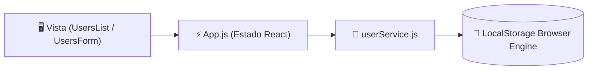

<div align="center">

# 👥 Users CRUD · Gestión Integral de Usuarios

[](https://reactjs.org/)
[](https://developer.mozilla.org/es/docs/Web/JavaScript)
[](https://www.w3.org/Style/CSS/)
[](https://developer.mozilla.org/es/docs/Web/API/Window/localStorage)
[](#)

<p align="center">
  <strong>Aplicación web React para la administración y ciclo de vida completo (CRUD) de usuarios.</strong><br>
  Creación, lectura detallada, edición y eliminación de perfiles con arquitectura de persistencia resiliente (LocalStorage) e interfaz responsive.
</p>

[✨ Funcionalidades](#-funcionalidades-clave) •
[🏛️ Arquitectura](#-arquitectura-del-proyecto) •
[💾 Persistencia Resiliente](#-persistencia-resiliente) •
[🚀 Guía de Instalación](#-guía-de-instalación-y-ejecución) •
[🤖 Créditos](#-créditos--asistencia-técnica)

</div>

---

## 📌 Visión General

**Users CRUD** es una aplicación desarrollada en **React** enfocada en el manejo de estado, formularios controlados y renderizado condicional. Originalmente conectada a un servicio REST externo, la arquitectura ha sido reforzada con una capa de servicio desacoplada (`userService.js`) que garantiza persistencia continua en `LocalStorage`.

---

## ✨ Funcionalidades Clave

* ➕ **Creación de Usuarios:** Formulario con validación de campos (`first_name`, `last_name`, `birthday`, `email`, `password`).
* 📋 **Listado Dinámico:** Renderizado en tiempo real con contador reactivo de usuarios.
* ✏️ **Edición Quirúrgica:** Modo edición con precarga automática de datos en el formulario y botón de cancelación.
* 🗑️ **Eliminación Segura:** Borrado inmediato con actualización automática de la memoria persistente.
* 📱 **Diseño Responsive:** Layout adaptativo a dos columnas en pantallas grandes y vista vertical apilada en móviles.
* 🛡️ **Zero Broken API:** Resiliencia ante caídas de backend; la aplicación funciona al 100% de manera autónoma.

---

## 🏛️ Arquitectura del Proyecto

```text
crudusers/
├── public/
│   ├── favicon.ico
│   ├── index.html                 # CDN de FontAwesome y montaje de root
│   └── manifest.json
├── src/
│   ├── components/
│   │   ├── UsersForm.js           # Formulario controlado (Create / Update)
│   │   └── UsersList.js           # Tarjetas visuales de usuarios con acciones
│   ├── services/
│   │   └── userService.js         # Capa de datos y persistencia en LocalStorage
│   ├── App.css                    # Estilos modernos, temas y responsive layout
│   ├── App.js                     # Componente contenedor y gestor del estado
│   └── index.js                   # Punto de entrada de React DOM
├── package.json
└── README.md
```

---

## 💾 Persistencia Resiliente

La aplicación implementa el patrón **Service Gateway** a través de `src/services/userService.js`:



* Los datos sobreviven al cierre de pestaña o recarga de página (`F5`).
* Al primer inicio, precarga automáticamente un semillero de usuarios de muestra para pruebas inmediatas.

---

## 🚀 Guía de Instalación y Ejecución

### 1. Clonar el repositorio
```bash
git clone https://github.com/Luaz2021/crudusers.git
cd crudusers
```

### 2. Instalar dependencias
Debido a la compatibilidad de paquetes en versiones modernas de Node.js (v18, v20, v22, v24), se recomienda el flag `--legacy-peer-deps`:
```bash
npm install --legacy-peer-deps
```

### 3. Ejecutar en desarrollo
```bash
npm start
```
La aplicación se abrirá automáticamente en tu navegador en [http://localhost:3000](http://localhost:3000).

---

## 🤖 Créditos & Asistencia Técnica

* **Desarrollo & Lógica Principal:** Alexander Martínez ([@Luaz2021](https://github.com/Luaz2021))
* **QA Tester, Auditoría de Código, Refactorización & Documentación README:** Generado por **Agent-Nova-Gemini-Assistant** ✨ (Copiloto y Asistente Técnico Autónomo basado en Google Gemini).

---
<div align="center">
  <sub>Desarrollado con fines educativos y de portfolio profesional · 2026</sub>
</div>
